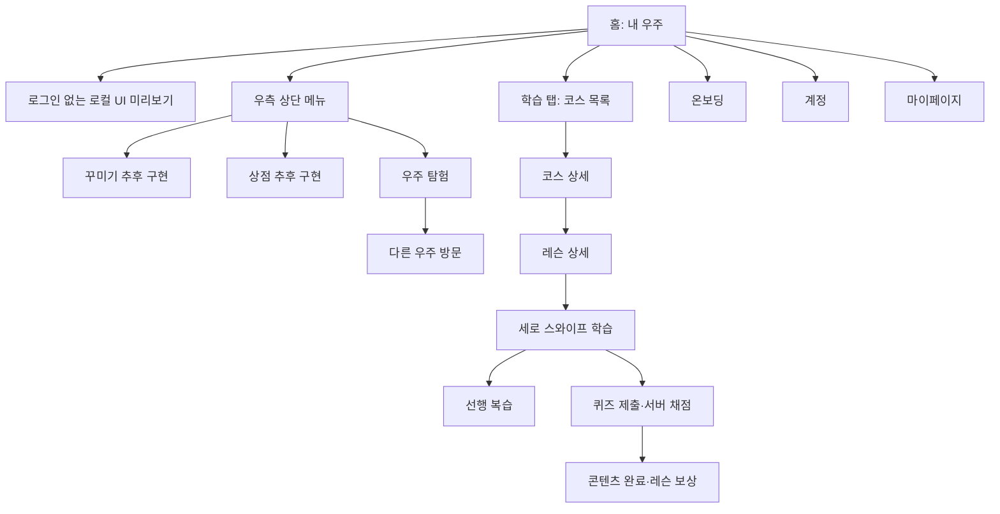

# 사용자 화면 흐름

일반 화면은 서버 데이터와 사용자 행동만 표시한다. 요청 Method·API 번호·JSON은 더보기 → 개발자 도구 → 기능 테스트/요청 기록에서 확인한다.

| 화면                                                | 입력·행동                                              | 성공 시                               | 실패 시                    | 연관 API    |
| --------------------------------------------------- | ------------------------------------------------------ | ------------------------------------- | -------------------------- | ----------- |
| UI 미리보기 `/preview`                              | 로그인 없이 메뉴·코스·레슨·스와이프 조작               | 로컬 화면 상태만 변경                 | 꾸미기·상점 추후 구현 표시 | 없음        |
| 홈 `/`                                              | `+` 메뉴 토글, 인벤토리·상점·탐험 이동, 내 우주 재조회 | 서버 이름·배치 표시                   | 연결 대기·재시도           | 701         |
| 계정 `/account`                                     | 게스트, 이메일·비밀번호, 인증코드, 로그인·로그아웃     | 계정 상태 갱신                        | 입력 유지·오류 표시        | 101~104,107 |
| 마이페이지 `/profile`                               | 닉네임·알림 설정 저장, 내 정보 재조회                  | 회원 정보·잔액·학습 진행 표시         | 오류·재시도                | 201,202     |
| 코스 `/quiz`                                        | 다음 학습, 별자리 기록·지도                            | 다음 레슨 학습 시작, 별자리 상세 이동 | 오류·재조회                | 401         |
| 코스 상세 `/learn/course/[courseId]`                | 레슨 선택, 다시 학습 확인                              | 바로 학습 시작                        | 오류·재조회                | 402~404     |
| 학습 `/learn/study/[lessonId]`                      | 위·아래 스와이프, 답안 선택·입력, 제출, 학습 완료      | 서버 채점·해설·진행도·보상 표시       | 현재 페이지 유지·재시도    | 404~408,904 |
| 복습 `/review`                                      | 문제 조회, 유형별 답안, 세션 완료                      | 채점·보상 표시                        | 빈 목록·오류 표시          | 501~503     |
| 온보딩 `/onboarding`                                | 시작, 퀴즈 제출, 완료·건너뛰기                         | 서버 완료·보상 표시                   | 오류·재시도                | 601,602,406 |
| 인벤토리 `/room/inventory`                          | 홈 메뉴에서 진입                                       | 추후 구현 안내 표시                   | 서버 요청 없음             | 없음        |
| 상점 `/room/shop`                                   | 홈 메뉴에서 진입                                       | 추후 구현 안내 표시                   | 서버 요청 없음             | 없음        |
| 탐험 `/social`                                      | 최신·인기, 커서 다음 페이지, 방문                      | 서버 목록 표시                        | 회원 안내·재시도           | 801         |
| 방문 `/social/[housingId]`                          | 좋아요·취소, 신고 사유·내용                            | 방문 상태 재조회·신고 접수            | 오류 표시                  | 802~805     |
| 개발자 도구 `/settings/dev-tools`, `/integration/*` | 명세 기능 개별 호출·요청 기록 선택                     | Method·경로·상태·마스킹된 JSON 표시   | 서버 코드·HTTP 표시        | 46개 목록   |

학습 퀴즈는 정답 여부와 관계없이 **제출 및 채점 결과 확인** 뒤 진행할 수 있다. 콘텐츠 완료는 별도 버튼으로 전송한다. 다시 하기는 콘텐츠 완료·레슨 보상 요청을 보내지 않는다. 홈의 방 모양은 중앙에 고정한다. 우측 상단 메뉴는 나머지 UI를 밀지 않고 펼쳐진다. 꾸미기·상점 편집 화면은 추후 구현한다.

방문 응답에 소유자 `userId`가 없어 일반 화면의 차단 버튼은 연결 대기다. 명세 변경 예정인 하우징 이름·공개 설정과 아바타 설정도 개발 화면에 보류 상태로 남긴다. OAuth·Push 수동 시험, 차단 수동 ID 시험은 개발 화면에서 접근한다.
